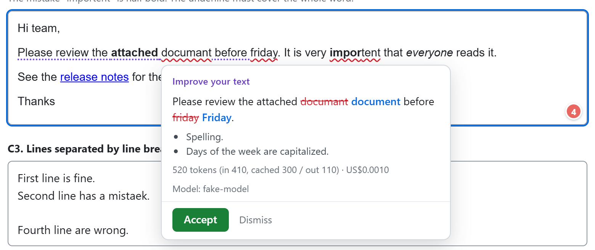
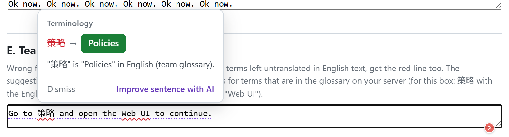
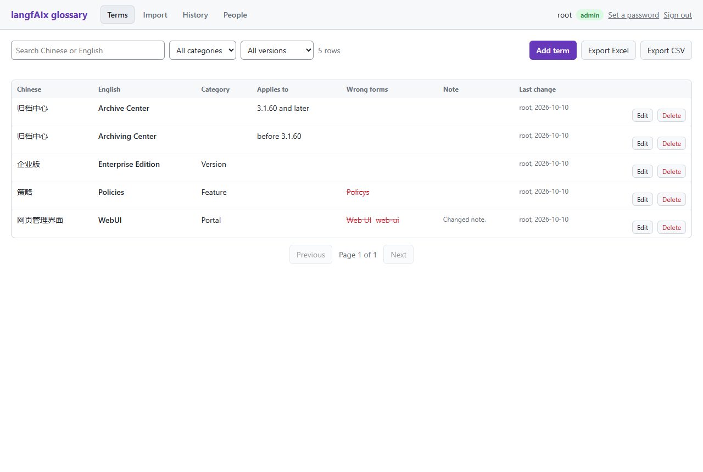
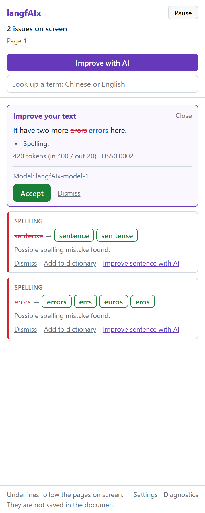

# langfAIx

**Language fix with AI.** A self-hosted, terminology-aware writing checker for teams.

[English](#english) | [中文](#中文)

---

## English

langfAIx underlines mistakes as you write, in web pages and in Microsoft Word, and fixes them with one click. It runs on your own server:

- **Rule checks** run automatically, through a self-hosted [LanguageTool](https://languagetool.org/).
- **A team glossary** (Chinese to English) keeps terminology consistent: standard terms are not flagged as typos, registered wrong forms are flagged, and Chinese terms left inside English text are flagged with the English term as the suggestion.
- **AI rewriting** runs only when you click, sentence by sentence, through your own LLM gateway. Every call shows its tokens and its cost.

It was built for teams that write English documentation from Chinese sources, but everything except the glossary's Chinese column works for any English writing.

| In a web page | Terminology |
|---|---|
|  |  |

| Glossary admin page | Word task pane |
|---|---|
|  |  |

The screenshots come from the automated browser tests and use made-up text. The task pane is shown as rendered in a test browser, not inside Word.

### What you get

- **Browser extension** (Chrome and Edge, Manifest V3): squiggles in `textarea`, `input` and rich-text editors (TinyMCE and similar, including editors in iframes), a suggestion card on hover, one-click replace with undo.
- **Word add-in** (Office.js): the same checks in Word for Windows, following the pages on screen, with a task pane for suggestions, AI rewriting and term lookup.
- **One backend** (FastAPI) for both, so prompts and glossary are managed in one place and users never see the provider key.
- **Glossary admin page**: add, edit, search, import from Excel or CSV, export, roles (viewer, editor, admin), change log, name-and-password sign-in.
- **Per-user keys and budgets** through [LiteLLM](https://github.com/BerriAI/litellm) virtual keys. Works with OpenAI and with self-hosted models (vLLM, Ollama), in which case no text leaves your network.
- **Personal dictionary**, stored on the user's own computer.
- **Languages**: English (US, UK, Australia, Canada), Chinese, Catalan, Dutch, French and German. Each user chooses the language of the text they write; the rule check and the AI rewrite follow it.

### Adjusting the AI prompt

The prompt is in [`backend/app/prompt.py`](backend/app/prompt.py). To say what your documents are about, or to add style preferences, set `AI_PROMPT_DOMAIN` and `AI_PROMPT_EXTRA` in `.env`; no code change is needed. The rules and the reply format are not configurable, because the code that reads the model's reply depends on them. Details in [docs/DEPLOY.md](docs/DEPLOY.md).

### Adapting the glossary

The glossary defaults to Chinese to English, which is what it was built for. `GLOSSARY_SOURCE_LANGUAGE`, `GLOSSARY_SOURCE_SCRIPT` and `GLOSSARY_CATEGORIES` change the source language, how it is recognised inside English text, and the default categories. `GLOSSARY_SOURCE_SCRIPT=none` makes it an English-only glossary of standard terms and wrong forms. See [docs/DEPLOY.md](docs/DEPLOY.md).

### Privacy by design

- AI never runs by itself. Automatic checks only use the rule engine on your server. Hints such as "this sentence could read better" are computed locally from the rule-check result and cost nothing.
- Only the sentence or selection the user picked is sent to the model.
- The backend does not store checked text, and does not store or log users' keys.
- Password fields, email, name, address, card and search inputs, and code editors are never checked.

### How it compares

| | langfAIx | LanguageTool's own extension with a self-hosted server | Harper | Grammarly Business |
|---|---|---|---|---|
| Self-hosted | yes | yes | runs in the browser | no |
| Rule checks | LanguageTool (open-source rules) | LanguageTool | its own rules, English only | proprietary |
| Team glossary with wrong forms | yes, Chinese to English | no | no | style guide, English |
| AI rewriting | on click, your own gateway, cost shown | no (cloud premium only) | no | yes, their cloud |
| Word | add-in, Windows, Microsoft 365 | official add-in | no | yes |
| License | AGPL-3.0 | LGPL-2.1 server | Apache-2.0 | commercial |

If all you need is spell and grammar checking in the browser, LanguageTool's own extension pointed at your server, or Harper, is simpler. langfAIx is for teams that also want an enforced glossary, AI rewriting under their own control, and Word.

### Limitations

- **Setup is not trivial**: five containers, and for the Word add-in a host name with an HTTPS certificate that users' computers trust.
- **The Word add-in** needs Word for Windows with a Microsoft 365 subscription (the annotation API it uses is subscription-only) and is installed by sideloading. Mac and Word for the web are untested.
- **Rule quality** is that of open-source LanguageTool, which is weaker than its premium service. Some agreement errors are not caught; the AI rewrite is meant to cover that.
- **No Google Docs** or other editors that draw text on a canvas.
- **The glossary** defaults to Chinese as the source language; other languages and an English-only mode are configurable but only Chinese has been tried. The interface is English only.
- **Languages other than English** are newer and less tried. AI rewriting in them has not been tested with real model calls. For Chinese there is no spell check (LanguageTool has none), the purple "could read better" hints do not appear, and single-line inputs are not checked.
- **One backend process**: the in-memory glossary is rebuilt on write, which assumes a single process.
- **The standalone compose file has not been run on a clean machine yet.** The stack that is known to work is the one behind Traefik; see [docs/DEPLOY.md](docs/DEPLOY.md).
- The install guides generated for users are in Chinese with English UI names; English versions are still to be written.
- One maintainer.

### Quick start

You need Docker with the compose plugin, and about 4 GB of memory.

```sh
cp .env.example .env        # then set the three secrets in .env
docker compose up -d --build
curl http://localhost/api/healthz
```

Then:

1. Open `http://localhost:4000/ui`, sign in with `admin` and your `LITELLM_MASTER_KEY`, add a model with the Public Model Name `langfAIx-model-1`, and create a virtual key for yourself.
2. Load the extension: open `chrome://extensions`, turn on Developer mode, click **Load unpacked** and pick the `browser-extension` folder. In its options, enter `http://localhost/api` and your virtual key.
3. Type into any text box.

For a real deployment (HTTPS, internal networks, the Word add-in, handing the extension to colleagues) see [docs/DEPLOY.md](docs/DEPLOY.md).

### Repository layout

```
backend/            FastAPI service: /check, /ai/improve, /glossary/..., the admin page
browser-extension/  Chrome Manifest V3 extension, plain JavaScript, no build step
word-addin/         Word add-in pages (plain HTML and JavaScript) and the manifest template
e2e/                browser tests that load the real extension and pages
deploy/             pack scripts, install scripts, compose examples
docs/               architecture and deployment
site/               the project's intro page: one static HTML file and its images
```

### Tests

```sh
cd backend && pip install -r requirements-dev.txt && python -m pytest
cd browser-extension && npm test
cd word-addin && npm test
cd e2e && npm install && npm run admin && npm run popup
```

The unit tests need no network and no keys. The other `e2e` scripts are described in [docs/ARCHITECTURE.md](docs/ARCHITECTURE.md).

### Roadmap

- A lite mode without LiteLLM and Postgres, talking to any OpenAI-compatible endpoint.
- English install guides.
- Chrome Web Store listing.
- Sync for the personal dictionary.
- Glossary: proposals with review, a term list per product version, pattern terms.

### Built on

langfAIx would not exist without these projects. Thank you to their authors and contributors.

- [LanguageTool](https://languagetool.org/) does the rule checking: spelling, grammar and style. langfAIx runs the unmodified open-source server in its own container and talks to it over HTTP.
- [LiteLLM](https://github.com/BerriAI/litellm) is the gateway to the model: it keeps the provider key, issues per-user virtual keys and budgets, and reports the cost of every call. langfAIx uses its unmodified container image and none of its enterprise-licensed features.
- [FastAPI](https://fastapi.tiangolo.com/), [SQLAlchemy](https://www.sqlalchemy.org/), [PostgreSQL](https://www.postgresql.org/), [Caddy](https://caddyserver.com/) and [Traefik](https://traefik.io/) hold the rest of the stack together.

Versions and licenses are in [THIRD-PARTY-NOTICES.md](THIRD-PARTY-NOTICES.md).

### License

Copyright (C) 2026 DestinyJazz.

langfAIx is free software under the [GNU Affero General Public License v3.0](LICENSE). You may use, modify and self-host it. If you run a modified version as a network service, the AGPL requires you to offer your modifications to its users.

Organisations that cannot use AGPL software, or that want deployment help, a support contract or enterprise features (single sign-on, audit export, review workflows), can get a commercial license. Open an issue to get in touch.

Third-party components are listed in [THIRD-PARTY-NOTICES.md](THIRD-PARTY-NOTICES.md). langfAIx is not affiliated with LanguageTool, Grammarly, Microsoft or OpenAI.

---

## 中文

langfAIx（language fix with AI）是一个自己架设的写作检查工具，给团队用：在网页输入框和 Microsoft Word 里自动划线，点一下就改。全部跑在你自己的服务器上。

- **规则检查 (rule check)** 自动运行，用的是自己架的 [LanguageTool](https://languagetool.org/)。
- **团队术语表 (team glossary)** 是一张中英对照表：标准译法不会被当成错字，登记过的错误写法会被提示，英文里夹着没翻译的中文术语也会被提示，建议就是对应的英文。
- **AI 改写**只在你点了之后才运行，一句一句地改，走你自己的 LLM 网关 (gateway)。每一次都显示用了多少 token、花了多少钱。

它是为"照着中文资料写英文文档"的团队做的。除了术语表的中文那一栏，其余功能对任何英文写作都适用。

### 有什么

- **浏览器扩展 (browser extension)**，支持 Chrome 和 Edge：`textarea`、`input` 和富文本编辑器（TinyMCE 之类，包括放在内嵌框架里的）都能划线，鼠标停上去弹出建议，点一下替换，可以撤销。
- **Word 插件 (Word add-in)**：Windows 版 Word 里同样的检查，跟着屏幕上的页面走，侧边栏里看建议、用 AI 改写、查术语。
- **一个后台 (backend)** 同时服务两边。提示词和术语表集中管理，使用者看不到模型服务商的 key。
- **术语表管理页面**：增删改查、从 Excel 或 CSV 导入、导出、三种角色、改动记录、名字加密码登录。
- **每人一把 key、各有预算**：用的是 [LiteLLM](https://github.com/BerriAI/litellm) 的虚拟 key (virtual key)。可以接 OpenAI，也可以接自己架的模型（vLLM、Ollama），那样文字完全不出内网。
- **个人词典**，存在使用者自己的电脑上。
- **语言**：英语（美国、英国、澳大利亚、加拿大）、中文、加泰罗尼亚语、荷兰语、法语、德语。每个使用者自己选写的是哪种语言，规则检查和 AI 改写都跟着它走。

### 调整 AI 提示词

提示词在 [`backend/app/prompt.py`](backend/app/prompt.py)。要说明你们写的是什么领域的文档，或者加上写作风格的偏好，在 `.env` 里设 `AI_PROMPT_DOMAIN` 和 `AI_PROMPT_EXTRA` 就行，不用改代码。规则和回复的格式不开放修改，因为读取模型回复的代码依赖它们。详见 [docs/DEPLOY.md](docs/DEPLOY.md)。

### 调整术语表

术语表默认是中文对英文，这是它当初为之设计的场景。用 `GLOSSARY_SOURCE_LANGUAGE`、`GLOSSARY_SOURCE_SCRIPT`、`GLOSSARY_CATEGORIES` 可以改源语言的名字、改"英文里夹着的源语言文字"怎么认、改默认分类。`GLOSSARY_SOURCE_SCRIPT=none` 就是只有英文的术语表：标准写法加错误写法。详见 [docs/DEPLOY.md](docs/DEPLOY.md)。

### 隐私

- AI 永远不会自己运行。自动运行的只有你服务器上的规则检查。"这句可以改得更好"这类提示是在本机用规则检查的结果算出来的，不花钱。
- 送给模型的只有使用者点的那一句或选中的那一段。
- 后台不保存检查过的文字，不保存也不记录使用者的 key。
- 密码、邮箱、姓名、地址、卡号、搜索框，以及写代码的地方，一律不检查。

### 限制

- **架设不简单**：五个容器。要用 Word 插件的话，还要一个域名和使用者电脑信任的 HTTPS 证书。
- **Word 插件**只支持 Windows 上订阅版 (Microsoft 365) 的 Word，用旁加载 (sideload) 的方式安装。Mac 和网页版没有试过。
- **规则质量**取决于开源版的 LanguageTool，比它的付费版弱，有些主谓不一致抓不到。这部分由 AI 改写来补。
- **不支持 Google Docs** 这类把文字画在 canvas 上的编辑器。
- **术语表**默认以中文为源语言。源语言和"只有英文"的模式可以用环境变量改，但只试过中文。界面只有英文。
- **英语以外的语言**是后来加的，试得少。这些语言的 AI 改写还没有用真的模型调用试过。中文没有拼写检查（LanguageTool 不提供），不会出现"可以改得更好"的淡紫色提示线，单行输入框里的中文不被检查。
- **仓库根目录的那份 compose 还没有在干净的机器上跑过。** 确定能用的是放在 Traefik 后面的那一套，见 [docs/DEPLOY.md](docs/DEPLOY.md)。
- 发给使用者的安装说明目前是中文加英文界面名称，英文版还没写。
- 只有一个人在维护。

### 快速开始

需要 Docker 和 compose 插件，约 4 GB 内存。

```sh
cp .env.example .env        # 然后在 .env 里填三个密钥
docker compose up -d --build
curl http://localhost/api/healthz
```

接着：

1. 打开 `http://localhost:4000/ui`，用 `admin` 和你的 `LITELLM_MASTER_KEY` 登录，加一个模型，Public Model Name 填 `langfAIx-model-1`，再给自己生成一把虚拟 key。
2. 加载扩展：打开 `chrome://extensions`，开启开发者模式，按 **Load unpacked**，选 `browser-extension` 文件夹。在扩展的设置页填 `http://localhost/api` 和你的虚拟 key。
3. 在任何输入框里打字试试。

正式部署（HTTPS、内网、Word 插件、把扩展发给同事）见 [docs/DEPLOY.md](docs/DEPLOY.md)，架构见 [docs/ARCHITECTURE.md](docs/ARCHITECTURE.md)。两份文档是英文的。

### 建立在这些项目之上

感谢这些项目的作者和贡献者：

- [LanguageTool](https://languagetool.org/) 负责规则检查（拼写、语法、文体）。langfAIx 用的是没有改动的开源服务器，放在自己的容器里，通过 HTTP 调用。
- [LiteLLM](https://github.com/BerriAI/litellm) 是通向模型的网关：保管服务商的 key，发放每人一把的虚拟 key 和预算，报告每次调用的成本。langfAIx 用的是它没有改动的容器镜像，没有用它需要企业授权的功能。
- [FastAPI](https://fastapi.tiangolo.com/)、[SQLAlchemy](https://www.sqlalchemy.org/)、[PostgreSQL](https://www.postgresql.org/)、[Caddy](https://caddyserver.com/)、[Traefik](https://traefik.io/) 撑起其余部分。

版本和许可证见 [THIRD-PARTY-NOTICES.md](THIRD-PARTY-NOTICES.md)。

### 许可证

langfAIx 是自由软件，采用 [GNU Affero General Public License v3.0](LICENSE)。你可以使用、修改、自己架设。如果你把改过的版本作为网络服务提供给别人用，AGPL 要求你向那些使用者提供你的修改。

不能使用 AGPL 软件的组织，或者需要部署协助、支持合同、企业功能（单点登录、审计导出、审核流程）的，可以取得商业授权 (commercial license)。请开一个 issue 联系。

用到的第三方组件列在 [THIRD-PARTY-NOTICES.md](THIRD-PARTY-NOTICES.md)。langfAIx 和 LanguageTool、Grammarly、Microsoft、OpenAI 没有关联。
